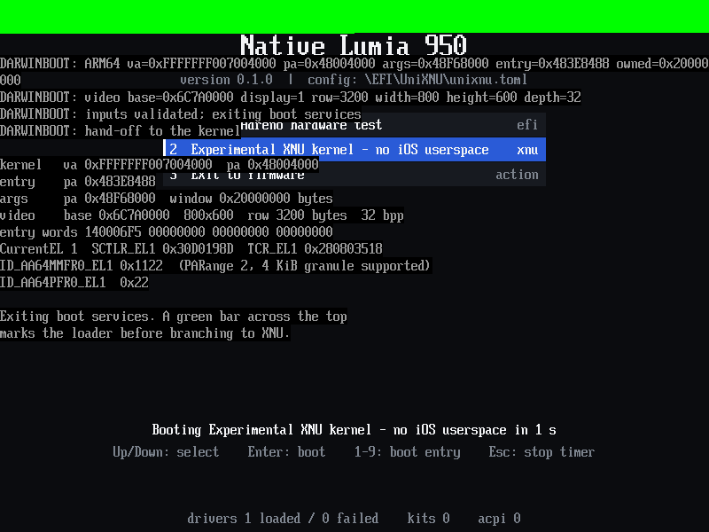

# What the emulation proves, and what it cannot

`scripts/test-native-xnu-entry.py` boots the real linked kernel under QEMU and reads its progress
with GDB breakpoints on real symbols. It is the only way this project can observe the kernel
executing without a handset, and this page is the boundary of that evidence.

## What a passing run means

Run 44003233713 is the reference. The fixture reached, in order:

```
arm_vm_init_entry → arm_vm_init_return
source_crypto_bootstrap_entry → return, status 0 (KERN_SUCCESS)
iokit_entry → iokit_return
kernel_bootstrap_entry
```

with the architectural counter at 19,200,000 Hz (the Lumia device-tree figure), `wfe_event_index`
4, and the report itself stating `emulator_only: true`, `handset_boot_observed: false`,
`ios_userspace_booted: false`. A CI step asserts those three fields, so an emulator result cannot
quietly become a handset claim.

## What it cannot mean

- **Not XNU-entry-tested.** That label needs the handset (`docs/evidence.json`).
- **Not a device.** QEMU's `virt` machine is not MSM8992: no eMMC controller, no MDSS, no Adreno,
  no PMIC, no SPMI, no RPM.
- **Not a boot past the interrupt controller with the phone's ADT.** With the staged bring-up ADT
  the kernel takes a data abort inside `ArmCpu::mapGic()` (ESR `0x96000010`): the ADT points the
  GIC at the Lumia's SoC windows and QEMU has no device there. That is why the fixture has
  `--adt-profile`.

## Running it locally (no CI, no Mac)

The fixture also runs on a plain Windows host, which is how the measurements below were taken
while the repository's Actions runs were unavailable:

```powershell
winget install --id SoftwareFreedomConservancy.QEMU -e
gh run download <RUN_ID> --repo hnmrxz/lumia950-ios-port -n lumia950-kernel -D out\kernel
gh run download <RUN_ID> --repo hnmrxz/lumia950-ios-port -n lumia950-stage  -D out\stage
python scripts\test-native-xnu-entry.py `
    --kernel "out\kernel\out\lumia950\tree\build\xnu\ios-obj\DEVELOPMENT_ARM64_BCM2837\mach.development.bcm2837.unstripped" `
    --esp out\stage --firmware "C:\Program Files\qemu\share\edk2-aarch64-code.fd" `
    --qemu "C:\Program Files\qemu\qemu-system-aarch64.exe" `
    --output out\local-qemu --timeout 240 --crypto-post --finish-iokit --adt-profile qemu
```

Windows has no emulator-side unix socket here, so the fixture speaks GDB over loopback TCP
(`--gdb-transport auto` picks it: tcp on Windows, unix on POSIX). A gate run takes about ten
seconds on TCG.

Its breakpoints are not written in the script: every milestone it can record comes from
`docs/native-checkpoints.json` (`checkpoint_symbols()`), the same list `check-checkpoints.py` judges
a handset log against. Adding a milestone means adding it there, with the kernel symbol that proves
it.

## When a run refuses to start

`--finish-bsd` checks the image for `_pthread_start` and `_source_pthread_bootstrap` first, because
a kernel without them panics inside `bsd_init` instead of producing a boot result. That refusal
names the configuration flag (`CONFIG_XNU_SOURCE_PTHREAD`) and
`scripts/check-kernel-link.py --config configs/lumia950_defconfig`, which is the same check the
kernel job runs before publishing an image.

## The qemu ADT profile

`board.toml [payload.adt.profiles.qemu]` keeps the bring-up shape (one CPU, no PSCI conduit, an
ownership bound) and moves the interrupt controller to where the emulated machine put one:
distributor `0x08000000`, CPU interface `0x08010000`.

Rules that keep it honest:

- it exists for the fixture only; both stagers emit no GIC window for `bringup` or `target`, which
  `scripts/test-adt-profile.py` pins;
- the fixture regenerates the ADT inside its temporary ESP copy and never writes into the staged
  artifact, and it runs `check-adt.py --profile qemu` on the result;
- `scripts/test-xnu-entry-adt.py` covers that step without QEMU.

## What the profile changed (local, 2026-11-17)

With the bring-up ADT the kernel data-aborted inside `ArmCpu::mapGic()` (ESR `0x96000010`). With
the qemu profile the same kernel gets past it: the run reaches all seven milestones —
`arm_vm_init`, `kernel_bootstrap`, the source crypto POST returning 0, `PE_init_iokit` — with
**no exception** (ESR 0, no stop symbol) and then it stops progressing without faulting.

The fixture now has two probes for that situation, and they named the blocker:

```
--watch _thread_block   hit:  pc _thread_block, x30 _lck_mtx_sleep+0x78
                        stack _ml_wait_max_cpus+0x64 ... _max_cpus_lock
--watch _fleh_irq       never hit over 45 s
--watch _fleh_fiq       never hit
--read  _max_cpus_initialized   = 2
--read  _real_ncpus             = 1
```

The 2 is not a CPU count: in `osfmk/arm/machine_routines_common.c` the loop is
`while (max_cpus_initialized != MAX_CPUS_SET)` with `MAX_CPUS_SET 0x1` and `MAX_CPUS_WAIT 0x2`, so
the value says "one thread is asleep waiting". It is woken only by `ml_set_max_cpus()`, whose caller
is `IOCPUInterruptController` in `iokit/Kernel/IOCPU.cpp` — the wait is for the platform interrupt
controller to register.

That never happens, and three more watches show why:

```
ArmCpu::start                     hit
ArmCpu::prepareGic                hit
gicv2::Controller::prepareDistributor  hit
gicv2::Controller::prepareLocal   never
gicv2::Controller::enableLocal    never
ArmCpu::enableGic / initCPU       never
```

`prepareGic()` is `mapGic -> prepareDistributor -> prepareLocal` (see `drivers/NativeGicV2/ArmCpu.patch`),
and `||` short-circuits: `prepareDistributor()` returned false, so everything after it — the CPU
interface, the local IRQ enable, the CPU registration — never ran. No CPU interrupt source exists,
so no IRQ is ever delivered, so nothing wakes the sleeping thread, and `bsd_init` is never entered.

`docs/emulation/2026-11-17-local-qemu-max-cpus-block.json` is the trimmed report, with the source
citations for each step.

The next question is therefore narrow: **which condition inside `prepareDistributor()` returns
false.** Its `fail()` and `verify()` helpers are inlined in the kernel build, so they have no
symbols; instead the fixture stops at the instruction after the call (`--break-at`, using the
return address it captured) and reads the controller's own state from `__ZL3gV2`:

```
x0 at the return site          0        (prepareDistributor returned false)
bound                          1
distributed                    0
interrupts                     288      (GICD_TYPER)
distributor PIDR2              0x2b     (GICv2, revision 3)
lastError                      4        (InvalidCpuTarget)
```

So the failing check is the CPU-target probe: it ORs `GICD_ITARGETSR` 0x800..0x81f and rejects a
zero result. QEMU's `hw/intc/arm_gic.c` returns zero for that whole range **only when the machine
has one CPU** ("For uniprocessor GICs these RAZ/WI"); with two or more it reports the CPU mask for
the banked range. The handset GIC is multiprocessor, so the probe is probably right on hardware and
this was an emulator configuration, not a port bug.

That is what `--smp` is for. With `--smp 2` the run goes further than any earlier one:

```
milestones: ... iokit_return, bsd_init_entry
watched:    prepareLocal hit (it was never reached with --smp 1)
stop:       _panic
panic:      "pthread kernel extension not loaded (function table is NULL). @%s:%d"
```

**The kernel enters `bsd_init`** — the last milestone before a root volume is needed — and then
panics because the pthread kext never registered its function table. The linked image does contain
`_pthread_functions`, `_pthread_kext_register` and the kext's symbols, so the gap is startup and
registration, not the link.

`docs/emulation/2026-11-17-local-qemu-bsd-init-panic.json` is the trimmed report.

The next question: **why the pthread kext does not start.** The answer is in the kernel artifact,
not in the emulator: `out/lumia950/kernel/kernel.json` lists exactly the nine components the
prelink merged, and the pthread kext is not one of them.

## Observing past bsd_init

`--finish-bsd` stops as soon as `bsd_init` is entered, which is exactly where the interesting part
begins once the pthread component is linked. `--past-bsd` is the observation mode for that:

- it implies `--finish-bsd`, and tolerates a kernel without the pthread provider (observing that
  panic is the point), recording `pthread_providers_missing`;
- after the entry it keeps going: `bsd_init_return` if the function returns, `_vfs_mountroot` as a
  watch, and the panic with its text if the kernel stops there;
- the report carries `past_bsd_outcome`: `returned`, `panicked`, `timed_out` or `stopped`.

Measured with the current kernel (local, 2026-11-17):

```
milestones            ... iokit_return, bsd_init_entry
past_bsd_outcome      panicked
panic_format          pthread kernel extension not loaded (function table is NULL). @%s:%d
watched               _vfs_mountroot: False
pthread_providers_missing  [_pthread_start, _source_pthread_bootstrap]
```

So the run now answers "and then what?" instead of stopping at the milestone. The CI observation
step uses this mode.

```
com.apple.AppleFSCompression.AppleFSCompressionTypeZlib  com.apple.driver.AppleEffaceableStorage
com.apple.filesystems.apfs                              com.apple.iokit.CoreAnalyticsFamily
com.apple.iokit.IOCryptoAcceleratorFamily                com.apple.iokit.IOStorageFamily
com.apple.kec.corecrypto                                com.apple.kext.CoreTrust
com.apple.security.AppleImage4
```

`board.toml [kernel.prelink] roots` names four of those, and the prelink adds what they declare as
libraries. The pthread kext is nobody's library dependency, so it is not in the closure, its start
routine never runs, `pthread_kext_register()` is never called, and `_pthread_functions` stays NULL.

The fix is a configuration flag, and the framework names it: `XNU_SOURCE_PTHREAD` builds
`build/libpthread-kernel/libpthread_kernel.a` and, with `patches/xnu/source-pthread-bootstrap.patch`,
registers it through `STARTUP(EARLY_BOOT, STARTUP_RANK_SECOND, source_pthread_bootstrap)`, which
calls `pthread_start()` so the function table is filled before `bsd_init`. `configs/lumia950_defconfig`
did not set it, so the component was never built.

```
image symbols              _pthread_functions, _pthread_kext_register   (the xnu shims)
                           pthread_start, source_pthread_bootstrap      ABSENT
```

`configs/lumia950_defconfig` now sets `CONFIG_XNU_SOURCE_PTHREAD=y`, and
`scripts/test-native-bringup.py::test_the_pthread_provider_must_stay_in_the_configuration` fails if
it disappears. What is not done is the verification: linking the source component needs the macOS
kernel job, so the next real image is the proof, not this repository state.

## Reading a report

`out/xnu-entry/report.json` (gate) and `out/xnu-entry-bsd/report.json` (observation). Fields worth
starting from:

| Field | Meaning |
|---|---|
| `milestones` | the ordered sequence actually observed |
| `stop_symbols` | a breakpoint name, or `_fleh_synchronous` when the kernel took an exception |
| `pc_symbol` | the symbol the stop PC falls in, e.g. `_kernel_bootstrap_thread+0x224` |
| `fault_elr_symbol` | the faulting instruction's site, e.g. `__ZN6ArmCpu6mapGicEv+0x444` |
| `fault_far` | the address the faulting access touched |
| `system_registers.esr_el1` | `0x96000010` is a synchronous external abort on a data access |

## The hand-off structure

`--dump-boot-args` reads the `boot_args` DarwinBoot built (its address is in the serial log) with the
same `pmemsave` path, decodes it with the arm64 layout from `pexpert/pexpert/arm64/boot.h`, and writes
`boot-args.json`. The first reading cross-checks against three independent records:

| Field | Value | Agrees with |
|---|---|---|
| `physBase` / `virtBase` | `0x48004000` / `0xFFFFFFF007004000` | the `DARWINBOOT: ARM64 …` line |
| video | `0x6c7a0000`, 800×600, row 3200, 32 bpp | that line *and* the kernel's `initialize_screen` |
| `deviceTreeLength` | `0x2c58` = 11352 | the staged `kernel.macho.adt` size |
| `commandLine` | `-v keepsyms=1 debug=0x100 cpus=1` | the `xnu` entry's `args` in the staged `unixnu.toml` |
| `memSize` | `0x20000000` | the ownership bound the bring-up profile asks for, not the full 0xaf600000 DRAM |

One defect came out of writing it down: the decoder first read `CommandLine` at `0x70` and produced
`eepsyms=1 …` — the field starts at `0x6c`, immediately after `deviceTreeLength`, so reading four
bytes late silently drops `-v `. `scripts/test-xnu-entry-adt.py` pins the offset now.

## The screen, as the machine left it

`--dump-framebuffer` (with `--dump-dmesg`) saves what the display controller actually holds. The
base comes from the kernel's own `initialize_screen` line, which is a **physical** address, so the
bytes are read with QEMU's monitor (`pmemsave`) rather than through the GDB stub — GDB speaks
virtual addresses and refuses that page.

The result is `framebuffer.ppm` plus a colour histogram in the report, and the first one looked like
this (`2026-11-17-qemu-boot-screen.png`):



It shows what the chain really rendered, not what a log claims: the UniXNU menu reading
"Native Lumia 950", the entries, the DarwinBoot verbose lines, the green bar across the top, and
"Booting Experimental XNU kernel - no iOS userspace in 1 s". That is also the surface a framebuffer
console would draw on, and the reason the colour histogram lists `00ff00` (the bar) next to the
dark background.

## The kernel's own log

A machine with no console still records what happened: XNU's `printf` goes through `msgbuf` as well
as the console, so the text is in kernel memory. `--dump-dmesg` extracts it at the stop and writes
`dmesg.txt` beside the report (`struct msgbuf` is a ring buffer, so `bufx`/`bufr` decide the order,
and the buffer is read in 4 KiB packets because the GDB stub refuses one huge read).

Measured locally on 2026-11-17 (8976 characters of a 128 KiB buffer), it answers questions the
milestones cannot:

- every `FIPSPOST_KEXT` test reports PASSED and `corecrypto_kext_start completed successfully`
  before the panic — the crypto POST is in the kernel's own record, not only in the fixture's status
  word;
- `initialize_screen: b=6C7A0000, w=00000320, h=00000258, r=00000C80` — the kernel adopts the
  DarwinBoot framebuffer as its screen, which is where a framebuffer console would write;
- `ml_processor_register` registers exactly one processor (`cpu_number 0`), matching the single-CPU
  ADT profile;
- `pe_arm_init_debug: failed to initialize gSocPhys == 0` is logged during interrupt bring-up — a
  warning worth following, not the stop;
- the log ends at `mbinit: done`, inside the BSD start, where the pthread panic happens.

On the emulator the log can simply be read out of memory. On a handset it still needs a way out,
which is what `docs/decisions/0001-log-transport.md` is about: this is the content that transport
has to carry.

**A panic is not in there.** Measured on 2026-11-17: with the buffer read at the `_panic`
breakpoint, and again after letting the panic run for a second and a half, `msgbuf` ends at
`mbinit: done` and the debug buffer (`_debug_buf_base` .. `_debug_buf_ptr`) stays empty. XNU's
panic prints to the console, and this machine has no console — the kernel even logs
"Serial requested, consistent debug disabled or debug boot arg not present, configuring debugging
over serial" and then finds nothing to talk to. The panic's format string is all that can be
recovered (the fixture records it as `panic_format`).

That is the argument for P1.1 in one measurement: on the handset a panic is an empty screen, and
the transport is what turns it back into a message. `--dump-dmesg` also appends the debug buffer when
a kernel keeps one, and `--panic-settle` exists for those kernels; for this one it buys nothing.

## Comparing two runs

A kernel change is judged by the difference between two reports, not by one:

```bash
python3 scripts/compare-xnu-reports.py out/before/report.json out/after/report.json \
    --require-milestones iokit_return,bsd_init_entry
```

It prints the milestones gained and lost plus the fields that moved (stop symbol, panic text, ADT
profile, crypto status), exits 3 when the later run lost a milestone or missed a required one, and
exits 0 otherwise. The CI job prints the same comparison between its gate and observation runs.

## The next thing to measure

The qemu profile answered one question and opened another: `mapGic` is behind us, and the boot CPU
now idles instead of faulting. What to measure next:

1. whether the timer interrupt is delivered at all in this machine (a breakpoint or a counter read
   on the interrupt entry path);
2. whether the bootstrap thread is runnable — `_bsd_init` is never entered, so either the thread is
   not scheduled or it is blocked before `bsd_init`;
3. only after that does the root volume question (`vfs_mountroot`) come up, because nothing in the
   emulated machine is an iOS root volume.

Each of those is a fixture change plus a run, not a hardware question.
